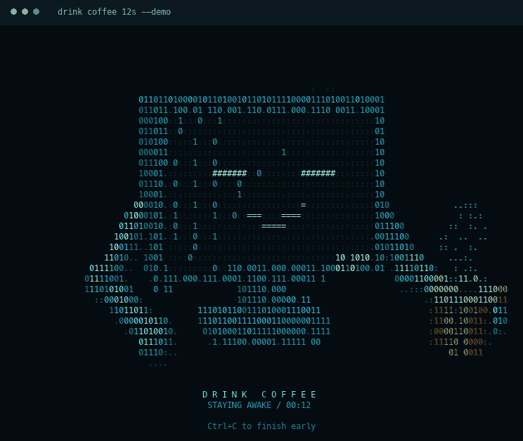

# drink coffee

Offer your Mac a coffee. It stays awake while a cyan ASCII computer sips from an amber mug.



```sh
drink coffee 30m
```

Native macOS app. No Python, Node, Homebrew, or administrator password needed to use it. Supports Apple silicon and Intel Macs running macOS 13 or later.

## Install

Paste this single command into Terminal:

```sh
curl -fsSL https://raw.githubusercontent.com/ketansahu07/drink-coffee/main/install.sh | sh && export PATH="$HOME/.local/bin:$PATH"
```

Then run `drink coffee 30m`. The installer downloads the latest release, checks its SHA-256 checksum, installs under `~/.local`, and adds the command to future zsh or bash sessions. The final `export` makes it available in the current terminal immediately. Running the installer again updates the app.

**For the repository owner:** this URL works after you upload this project and publish its first release. See [Publishing](#publishing).

## Use

```sh
drink coffee                 # 30 minutes
drink coffee 30m             # 30 minutes
drink coffee 2h              # 2 hours
drink coffee 90s             # 90 seconds
drink coffee 2h30m15s        # 2 hours, 30 minutes, 15 seconds
drink coffee 2h 30m 15s      # the same duration, with spaces
drink coffee for 2h 30m 15s  # "for" is optional
```

Press **Ctrl+C** to finish early. When the timer ends, normal sleep behavior resumes.

```sh
drink coffee 30m --screen        # keep the display awake, too
drink coffee 30m --no-animation  # just the keep-awake timer
drink coffee 15s --demo          # preview the animation without preventing sleep
drink --help
drink --version
```

Durations must be positive and at most 7 days. Use explicit units: `30m`, not a bare `30`. A dark terminal and a larger window give the animation more detail. `NO_COLOR=1` disables color, and redirected output automatically uses a plain status message.

## How it works

For a 30-minute session, the app launches macOS's `/usr/bin/caffeinate` with `-i -t 1800 -w <drink-pid>`. `--screen` also adds `-d`. The app stops only its own caffeinate process when the session finishes or you press Ctrl+C. The parent-process watch also releases the request if the app is killed unexpectedly.

The command prevents automatic sleep caused by inactivity. Keep the MacBook lid open; it does not override lid closure, manually choosing Sleep, or low-battery sleep. The animation and sleep request run together in the current terminal session; closing the terminal ends the session.

## Build locally

Building requires the Xcode command-line tools with Swift 5.9 or newer. End users installing a release do not need them.

```sh
swift test
python3 scripts/test-runtime.py .build/debug/drink
swift build -c release
.build/release/drink coffee 10s --demo
```

Create a universal release for both Mac architectures:

```sh
sh scripts/build-release.sh
sh scripts/test-installer.sh
sh install.sh --local dist/drink-macos-universal.tar.gz
export PATH="$HOME/.local/bin:$PATH"
```

## Publishing

Create a public GitHub repository named `ketansahu07/drink-coffee`, upload the contents of this directory with `main` as the default branch, then push a version tag:

```sh
git tag v0.1.0
git push origin v0.1.0
```

The included **Release** workflow tests the app, builds a universal macOS executable, and publishes the archive and checksums to GitHub Releases. Once that workflow succeeds, share the repository link and the one-command installer above.

For later versions, update `VERSION` and the CLI version together before tagging. A fork can use `DRINK_REPO=owner/repository` when invoking the installer; update the README URL for that fork as well.

## Uninstall

```sh
curl -fsSL https://raw.githubusercontent.com/ketansahu07/drink-coffee/main/uninstall.sh | sh
```

This removes this app's executable and command link. The shared `~/.local/bin` PATH entry is retained for other tools.

## License

[MIT](LICENSE)
